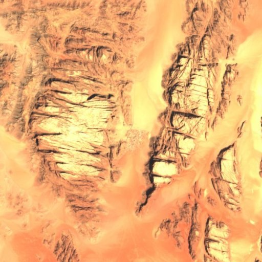
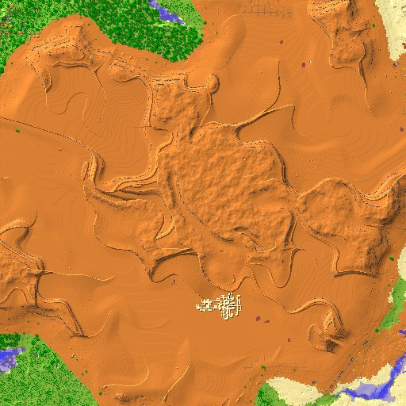
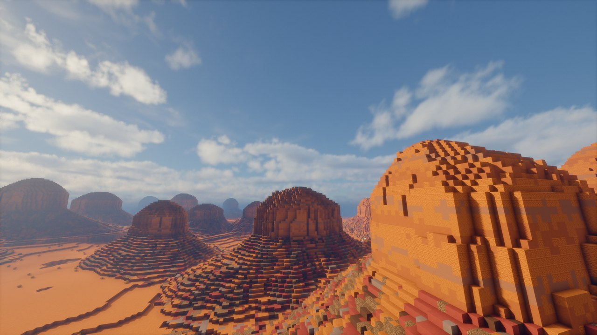

# Wadi Rum / 와디 럼

**Real place:** Wadi Rum (Jabal Ram), Jordan (29.5760, 35.4200)

Red sand valleys between towering sandstone and granite inselbergs with smooth domed tops and vertical walls; natural arches and narrow siqs.

**In game:** `biomesmod:wadi_rum`, a site of 652–798 blocks across (flat plateau, y=102). Find the nearest one with `/biomesmod sites wadi_rum`.

| Satellite (real place) | In-game map (top-down) | In-game view |
|---|---|---|
|  |  |  |

Satellite: [Sentinel-2 cloudless 2016 by EOX IT Services GmbH (contains modified Copernicus Sentinel data 2016)](https://s2maps.eu), CC BY 4.0 ([licence](https://creativecommons.org/licenses/by/4.0/)). In-game images: seed 0, Minecraft 26.2; the view uses Iris + Bliss shaders, Sodium and Voxy.

[Back to the gallery](README.md)
