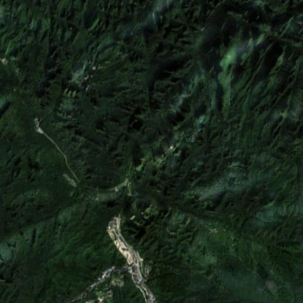
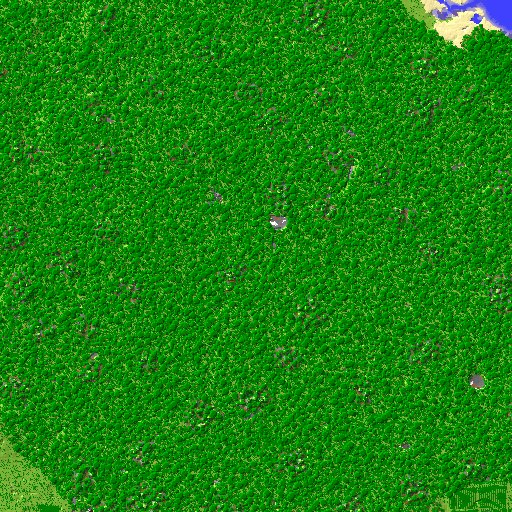
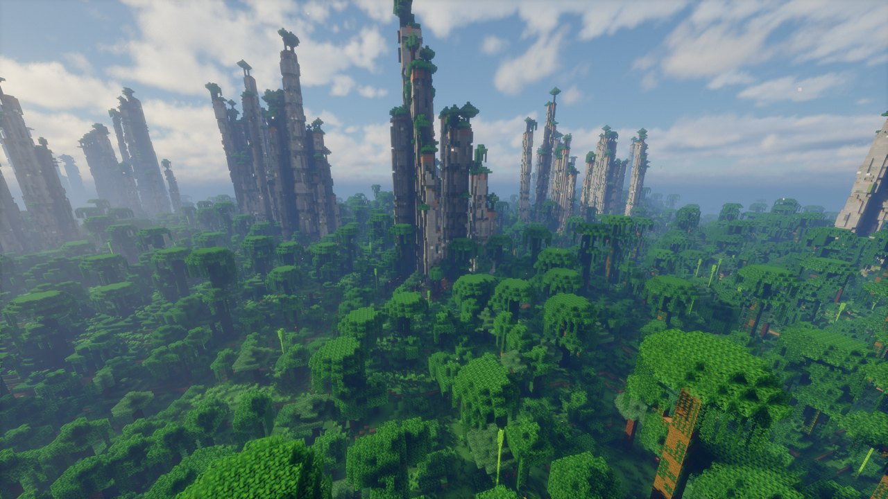

# Zhangjiajie Pillars / 장자제 석주림

**Real place:** Zhangjiajie National Forest Park (Wulingyuan), China (29.3240, 110.4340)

Over 3,000 quartz-sandstone pillars, many above 200 m, rise from a misty subtropical forest; their flat tops carry pines.

**In game:** `biomesmod:zhangjiajie`, a site of 920–1200 blocks across (raised land, y=90). Find the nearest one with `/biomesmod sites zhangjiajie`.

| Satellite (real place) | In-game map (top-down) | In-game view |
|---|---|---|
|  |  |  |

Satellite: [Sentinel-2 cloudless 2024 by EOX IT Services GmbH (contains modified Copernicus Sentinel data 2024)](https://s2maps.eu), CC BY-NC-SA 4.0 ([licence](https://creativecommons.org/licenses/by-nc-sa/4.0/)). In-game images: seed 0, Minecraft 26.2; the view uses Iris + Bliss shaders, Sodium and Voxy.

[Back to the gallery](README.md)
